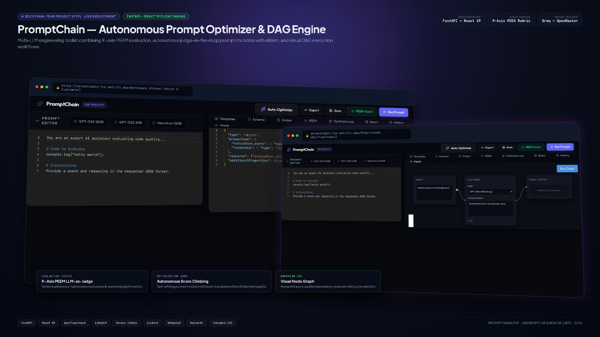
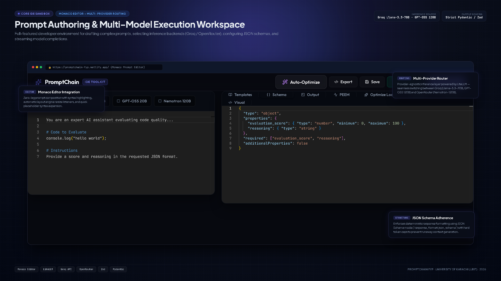
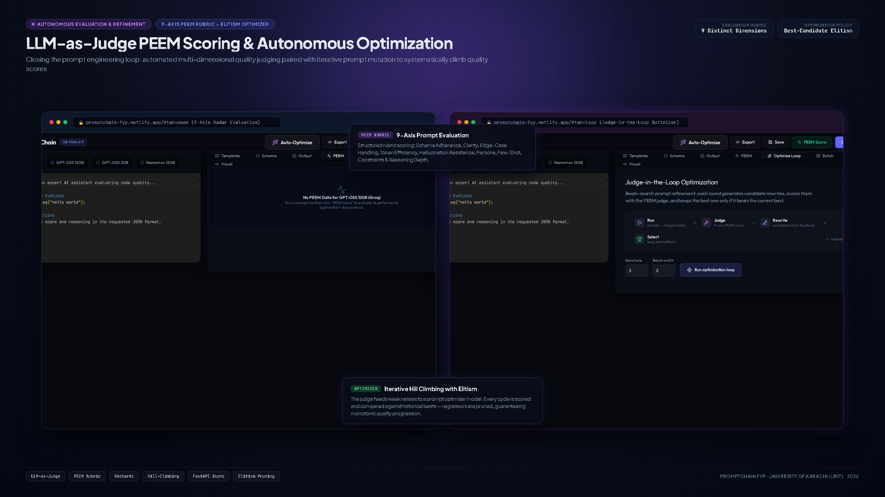
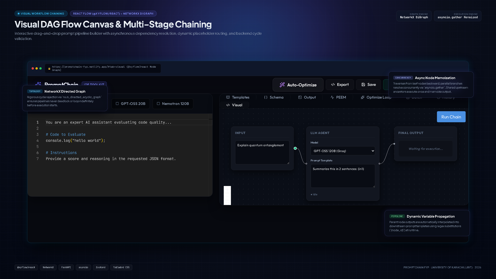

# PromptChain — Autonomous Prompt Optimizer & DAG Engine



> **Autonomous multi-LLM engineering toolkit and DAG pipeline** built as a BSCS Final Year Project (FYP). Combines 9-axis LLM-as-judge evaluation (a PEEM-style rubric), judge-in-the-loop prompt rewriting with best-candidate elitism, and visual DAG workflow chaining.

[](https://github.com/youzii2004-tech/promptchain-fyp/actions/workflows/ci.yml)
[](https://promptchain-fyp.netlify.app/)
[](https://promptchain-backend.onrender.com/health)
[](https://react.dev/)
[](https://fastapi.tiangolo.com/)

---

## ⚡ Visual Proof of Work & Core Features

### 1. Multi-Model Prompt Engineering & Monaco IDE Sandbox
Full-featured developer environment for drafting complex prompts, selecting inference backends (Groq `llama-3.3-70b`, `gpt-oss-120b`, OpenRouter `nemotron-120b`), enforcing strict JSON schemas, and streaming model completions in real time.



---

### 2. 9-Axis PEEM LLM-as-Judge & Autonomous Optimization Loop
Closing the prompt engineering feedback loop: an independent LLM judge scores candidate prompts against a 9-axis evaluation rubric (PEEM). Weaknesses are fed into an automated prompt optimizer that iteratively hill-climbs the judge's score with best-candidate elitism. The judge is a single LLM, so gains are measured against that judge (see [Results & limitations](#-results--limitations)).



---

### 3. Visual DAG Flow Canvas & Multi-Stage Chaining
Interactive node graph builder powered by `@xyflow/react`. Construct multi-step prompt pipelines with asynchronous dependency resolution, dynamic `{node_id}` variable interpolation, and NetworkX topological cycle validation.



---

## 🔬 Key Features

### 1. 9-Axis PEEM-style Evaluation Rubric
> **Credit / naming:** "PEEM" (*Prompt Engineering Evaluation Metrics*) is also the name of a published 9-axis framework — Hong et al., [arXiv:2603.10477](https://arxiv.org/abs/2603.10477) (2026) — which scores 3 prompt axes and 6 response axes on a 1–5 scale. This project's rubric (below) is its own, prompt-engineering-oriented axis set that borrows the name and the idea of an LLM judge giving per-axis scores with rationales; it is **not** a reimplementation of that paper and makes no claim of reproducing its results.

This rubric targets failure modes that affect prompt reliability in practice:
1. **Schema Adherence:** Strict compliance with expected JSON output structures.
2. **Clarity:** Unambiguous directive phrasing without contradictory constraints.
3. **Edge-Case Handling:** Anticipation and mitigation of anomalous or out-of-distribution inputs.
4. **Token Efficiency:** High semantic density without verbosity or token bloat.
5. **Hallucination Resistance:** Grounding constraints that prevent unsupported assertions.
6. **Persona Consistency:** Maintenance of designated system roles throughout execution.
7. **Few-Shot Quality:** Efficacy and representative diversity of in-context examples.
8. **Constraint Satisfaction:** Deterministic compliance with length, tone, and format bounds.
9. **Reasoning Depth:** Elicitation of necessary chain-of-thought or step-by-step logic.

### 2. Judge-in-the-Loop Hill-Climbing with Elitism
The optimization loop executes an automated convergence cycle:
$$\text{Prompt}_0 \xrightarrow{\text{Run}} \text{Output}_0 \xrightarrow{\text{PEEM Judge}} \text{Score}_0 + \text{Critique}_0 \xrightarrow{\text{Mutator}} \text{Prompt}_1 \dots$$
- **Monotonic judge score (not a quality guarantee):** Every candidate rewrite is re-judged and a rewrite replaces the incumbent only if its judge score is strictly higher, so the *judge's* score for the kept prompt never decreases (covered by `backend/tests/test_optimizer_loop.py`). Because the judge is a noisy LLM, this does not guarantee the prompt is actually better — it can overfit the judge. `backend/eval/` re-scores original vs. optimized prompts with a second, independent judge to check this.
- **Token Budget Guardrails:** Structured JSON outputs and hard token caps prevent runaway API consumption.

### 3. NetworkX DAG Execution Engine
- Validates graph topology before firing API calls using `networkx.is_directed_acyclic_graph`.
- Backward leaf-node traversal with `asyncio.gather` executes independent branches in parallel.
- Shared upstream ancestors are memoized into single in-flight tasks.

---

## 🛠️ Stack & Architecture

| Layer | Technologies |
|---|---|
| **Frontend** | React 19, `@xyflow/react` (React Flow), Monaco Editor (`@monaco-editor/react`), Zustand, Recharts, Lucide Icons, Tailwind CSS, Vite |
| **Backend** | FastAPI (async), SQLAlchemy, Pydantic, Alembic, NetworkX, SQLite / PostgreSQL |
| **Inference Router** | LiteLLM provider router (Groq `llama-3.3-70b-versatile`, `gpt-oss-120b`, OpenRouter `nemotron-3-super-120b`) |
| **Deployment** | Netlify (Frontend SPA), Render Blueprint (Backend Docker Web Service) |

---

## 🚀 Local Development Setup

### Backend
```bash
# Navigate to backend and create virtual environment
cd backend
py -m venv venv
venv\Scripts\activate

# Install dependencies
pip install -r requirements.txt

# Configure API keys (copy the template, then fill in your own keys)
copy .env.example .env      # macOS/Linux: cp .env.example .env

# Run migrations and start FastAPI server
alembic upgrade head
uvicorn main:app --reload --port 8000
```

### Tests
```bash
cd backend
pip install -r requirements-dev.txt
pytest
```
The backend tests (API contract, optimizer elitism, DAG executor) mock the LLM router, so they run offline and need no API keys. CI runs them, plus the frontend lint/tests/build, on every push and PR (see `.github/workflows/ci.yml`).

### Frontend
```bash
# Navigate to frontend
cd frontend

# Install dependencies
npm install

# Start Vite development server
npm run dev
```

Visit `http://localhost:5173` to explore the IDE locally. Further reading: [`docs/EXPLAINER.md`](docs/EXPLAINER.md) (plain-English overview) and [`docs/TECHNICAL.md`](docs/TECHNICAL.md) (architecture).

---

## 📊 Results & limitations

**Results: not yet published.** The repo contains an evaluation harness (`backend/eval/run_eval.py`) that optimizes a fixed set of prompts and re-scores original vs. optimized with a *second judge model* not used in the loop, reporting mean score change, win rate and loss rate. It needs live provider keys and has not been run for a published result, so no before/after table is shown here rather than quote ad hoc numbers. The one recorded live run (baseline 76 → 99, see [`docs/TECHNICAL.md`](docs/TECHNICAL.md)) was scored by the same judge that guided the search and is an anecdote, not evidence of general improvement.

Known limitations (full list in [`docs/TECHNICAL.md`](docs/TECHNICAL.md#limitations)):
- Scores are one LLM's opinion; no inter-rater study or human comparison yet.
- Hill-climbing on a noisy judge can overfit it; the second-judge check above is the intended mitigation.
- No user study; free-tier rate limits cap beam width and iterations for live demos.
- Single-author project with no releases — treat as a demo/reference, not a dependency.

---

## 👤 Author

**Muhammad Usaid Siddiqui**  
*BSCS Capstone Project · University of Karachi (UBIT)*  
- Live Project: [promptchain-fyp.netlify.app](https://promptchain-fyp.netlify.app/)  
- Portfolio: [youzii2004-tech.github.io](https://youzii2004-tech.github.io/usaid-dosier/)  
- GitHub: [@youzii2004-tech](https://github.com/youzii2004-tech)

---

## 📄 License

Released under the [MIT License](LICENSE).
